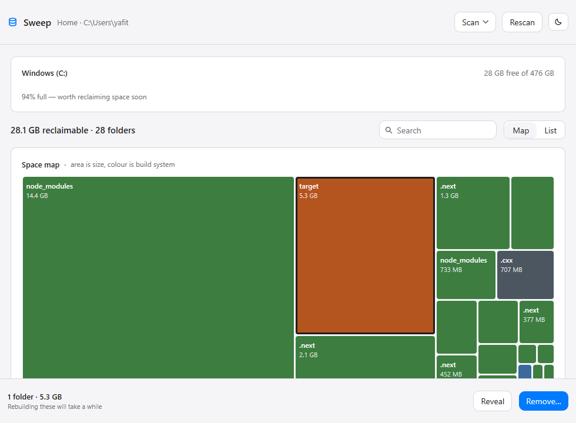
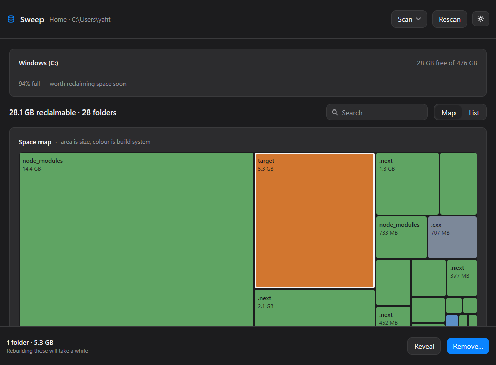
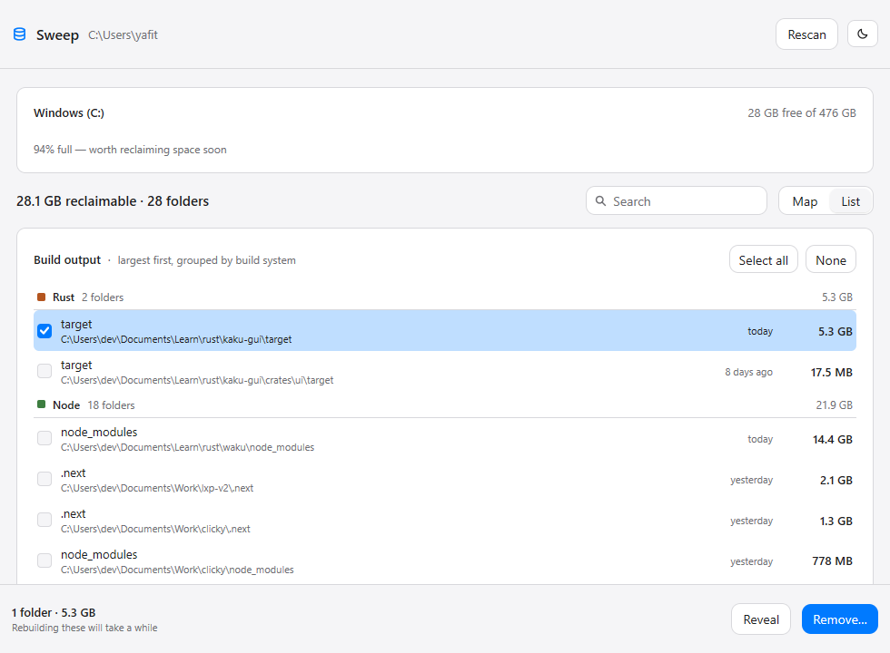

<p align="center">
  
</p>

<h1 align="center">Sweep</h1>

<p align="center">
  Find the build output eating your disk, and remove it in one pass.
</p>

---

Rust, Node, Python, Gradle and Android builds leave multi-gigabyte directories
behind — `target/`, `node_modules/`, `.next/`, `.cxx/` — one per project, in
places you have forgotten. `cargo clean` only knows the project you are standing
in; Explorer gives you no idea which folder is worth the walk.

Sweep walks your disk, finds every one of them, and shows you where the space
went and what is safe to delete.

Built with [MyGo](https://github.com/egoist/mygo) — pure Go, no cgo, no webview,
drawn on the GPU. One 11 MB binary that opens instantly.

## What it does

- **Finds regenerable build artifacts** across the disk: Rust `target`, Node
  `node_modules` and framework caches, Python caches and virtualenvs, Gradle and
  Android build trees, Xcode `DerivedData` and `Pods`, CMake trees.
- **Maps them** as a squarified treemap: area is size, colour is the build
  system. One look answers "where did it all go".
- **Lists them** grouped by build system with exact paths, sizes and how long
  ago each changed, so you can see which project you have abandoned.
- **Removes the ones you choose**, permanently, after a confirmation that names
  the count and the total, with progress while it runs.
- **Shows the disk's own capacity** with the same amber/red levels the system's
  storage pane uses, so "is it bad?" is answerable in the app.

## Screenshots

| Space map (light) | Space map (dark) |
|---|---|
|  |  |

The list is the actionable view: the same artifacts grouped by build system,
largest first, with a checkbox on every row.



## Safety

A tool that deletes directories has to be boring about it. Sweep is:

- **A name alone is never enough.** A directory called `target` is only Cargo's
  when it holds the `CACHEDIR.TAG` Cargo writes; `build` must sit beside a
  Gradle file; `obj` beside a `.csproj`; `Pods` beside a `Podfile`. A folder
  that merely happens to share a name is left alone.
- **Guards before removal, not after.** Every path is re-checked as absolute,
  not a volume root, deep enough, not your home directory, and not a link. A
  selection containing both a folder and something inside it is refused
  outright rather than half-applied.
- **Links and junctions are never followed**, so a build tree reached through a
  junction is not deleted through it, and Windows' own junctions cannot make the
  scan loop forever.
- **Nothing is touched without confirmation.** The dialog names the count and
  the size and says plainly that removal is permanent and the next build will
  take longer.

Removal is permanent rather than to the Recycle Bin on purpose: moving files to
the bin does not free the space until it is emptied, which is the entire point.

## Install

Download the installer from [Releases](https://github.com/yaffalhakim1/sweep/releases/latest)
and run it. It installs per user to `%LOCALAPPDATA%\Programs\Sweep` with no
administrator prompt, and adds a Start Menu entry. Uninstall from Settings, Apps.

Two builds are published: pick `amd64` for Intel and AMD, `arm64` for Windows on
ARM. If you are not sure, `amd64` runs on both.

## Build

Needs [Go](https://go.dev/dl/) 1.27 or later. No other toolchain, no Node, no
webview runtime.

```sh
go tool mygo build      # Sweep.exe and the installer, in build/windows-amd64
go tool mygo dev        # run with live reload
go test ./...           # the tests
```

## How it is put together

```
main.go              the window
internal/scan/       artifact rules, the parallel walker, sizing
internal/clean/      permanent removal, and the guards that stop it
internal/treemap/    squarified treemap layout (pure geometry)
internal/disk/       volume capacity and free space
internal/app/        state, theme, palette, views
```

The layers below `internal/app` import no UI package at all, so the rules, the
walker, the treemap and the deletion guards are all unit-testable without a
window. The treemap depends on nothing.

### Notes worth knowing if you change it

Two things cost real debugging time, and both are easy to reintroduce:

- **`.Fill()` cannot resolve inside a `Scroll`.** It sizes against the parent's
  *definite* size, and a scroll container has none, so a filling child collapses
  to zero. The content column takes an explicit width from `c.Size()`, and cards
  use `.FillWidth()`. A box with a fixed height uses `.FillWidth().Height(h)` —
  never `.Fill()` after `.Height(h)`, which overrides it.
- **`PointerPosition()` is element-local; a `Draw` callback's rect is in painted
  coordinates.** They differ by the element's own origin, so comparing them
  directly shifts a hit test by that much. Both the map's draw callback and its
  hit test go through `layout()` and convert once, which is also what makes the
  two agree.

`implementation_plan.md` documents the rest of the design decisions.

## Landing page

`landing/` is the site GitHub Pages publishes. It is static HTML, one
stylesheet and two scripts — no build step, no framework, no dependency.

```sh
cd landing
python -m http.server 8801    # preview at http://127.0.0.1:8801/
```

The page is a **Stat-Led** shape built on the **Cobalt** theme: the hero is a
real measurement from a real disk (22.1 GB across 42 build directories, found in
3.7 s), the middle is the guard table of what Sweep refuses to delete, and the
terminal block shows actual scan output rather than invented numbers. The two
app captures are rendered by the view tests, so they cannot drift from the code.

`landing/tokens.css` holds every colour and font the page uses. Nothing in
`index.html` inlines a colour value, which is what keeps the system portable.

The numbers in the copy are measurements, not estimates. If you change the
scanner, re-measure before changing them — a landing page quoting a stale figure
is worse than one quoting none.
