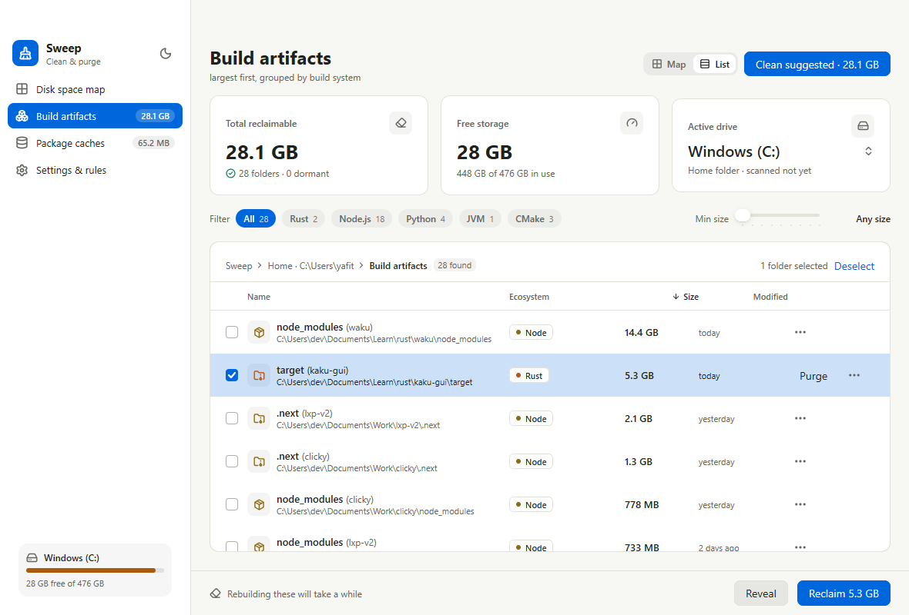
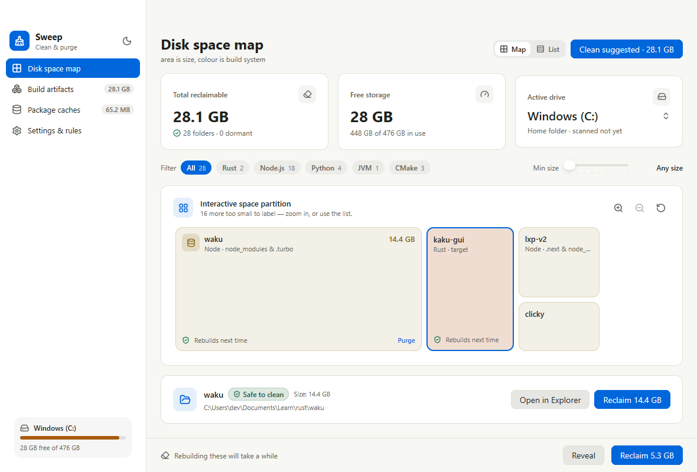
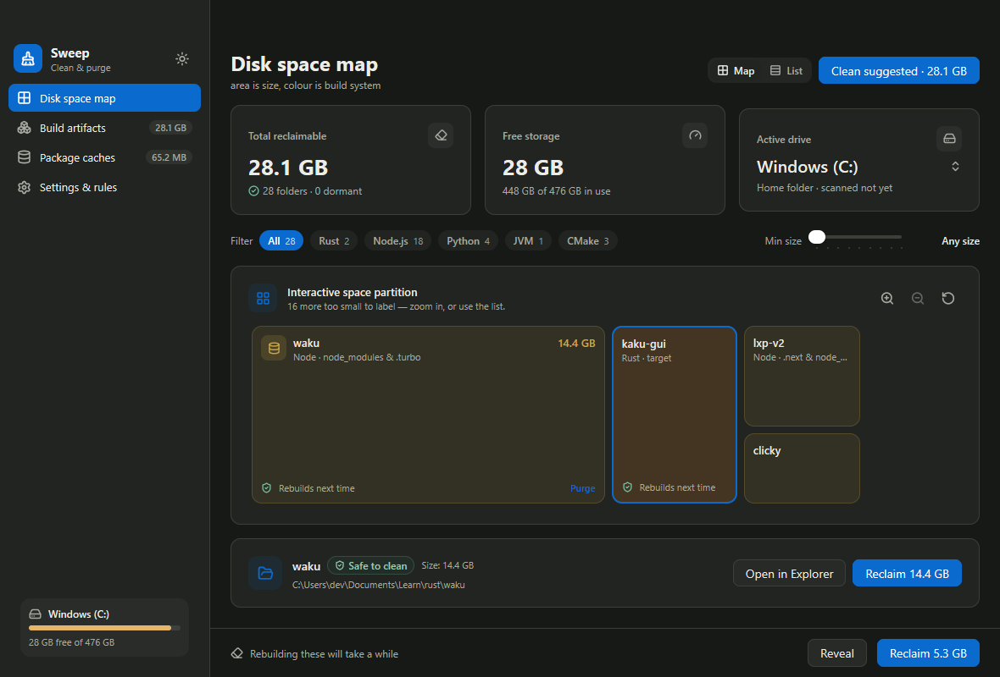

<p align="center">
  
</p>

<h1 align="center">Sweep</h1>

<p align="center">
  Find the build output eating your disk, and remove it in one pass.
</p>

---

Rust, Node, Python, Gradle and Android builds leave multi-gigabyte directories
behind — `target/`, `node_modules/`, `.next/`, `.cxx/` — one per project, in
places you have forgotten. `cargo clean` only knows the project you are standing
in; Explorer gives you no idea which folder is worth the walk.

Sweep walks your disk, finds every one of them, and shows you where the space
went and what is safe to delete.

Built with [MyGo](https://github.com/egoist/mygo) — pure Go, no cgo, no webview,
drawn on the GPU. One 11 MB binary that opens instantly.

## What it does

- **Finds regenerable build artifacts** across the disk: Rust `target`, Node
  `node_modules` and framework caches, Python caches and virtualenvs, Gradle and
  Android build trees, Xcode `DerivedData` and `Pods`, CMake trees.
- **Maps them by project**: a squarified partition where a tile is one project's
  build output, its area is its size, and its tint is the build system. One look
  answers "which project is eating the disk". A tool's own store — nvm's
  per-version `node_modules`, npm's cache — is one tile called *Package
  managers*, because "which project" has no answer for it.
- **Lists them** in a table with exact paths, sizes and how long ago each
  changed, so you can see which project you have abandoned. Sort by name,
  ecosystem, size or date; filter by ecosystem and by a minimum size.
- **Separates the cheap wins**: package caches are regenerated by the next run
  rather than the next build, so they have their own page.
- **Removes the ones you choose**, permanently, after a confirmation that names
  the count and the total, with progress while it runs.
- **Shows the disk's own capacity** with the same amber/red levels the system's
  storage pane uses, so "is it bad?" is answerable in the app.
- **Says what it looks for**: the Settings & rules page prints the live rule
  table, including which names need a proof file and which do not.

## Screenshots

| Build artifacts (light) | Space map (light) |
|---|---|
|  |  |

| Space map (dark) | |
|---|---|
|  | |

The list is the actionable view: the same artifacts, largest first, with a
checkbox on every row and the total of what is chosen in the footer.


## Safety

A tool that deletes directories has to be boring about it. Sweep is:

- **A name alone is never enough.** A directory called `target` is only Cargo's
  when it holds the `CACHEDIR.TAG` Cargo writes; `build` must sit beside a
  Gradle file; `obj` beside a `.csproj`; `Pods` beside a `Podfile`. A folder
  that merely happens to share a name is left alone.
- **Guards before removal, not after.** Every path is re-checked as absolute,
  not a volume root, deep enough, not your home directory, and not a link. A
  selection containing both a folder and something inside it is refused
  outright rather than half-applied.
- **Links and junctions are never followed**, so a build tree reached through a
  junction is not deleted through it, and Windows' own junctions cannot make the
  scan loop forever.
- **Nothing is touched without confirmation.** The dialog names the count and
  the size and says plainly that removal is permanent and the next build will
  take longer.

Removal is permanent rather than to the Recycle Bin on purpose: moving files to
the bin does not free the space until it is emptied, which is the entire point.

## Install

**[Download the installer](https://github.com/yaffalhakim1/sweep/releases/latest/download/Sweep-setup.exe)** and run it. It installs per
user to `%LOCALAPPDATA%\Programs\Sweep` with no administrator prompt, and adds a
Start Menu entry. Uninstall from Settings, Apps.

That link is the `amd64` build, which runs on Intel, AMD and Windows on ARM. A
native `arm64` build is on the [releases page](https://github.com/yaffalhakim1/sweep/releases/latest)
for Windows on ARM machines.

## Build

Needs [Go](https://go.dev/dl/) 1.27 or later. No other toolchain, no Node, no
webview runtime. The release process is in [RELEASING.md](RELEASING.md).

```sh
go tool mygo build      # Sweep.exe and the installer, in build/windows-amd64
go tool mygo dev        # run with live reload
go test ./...           # the tests
```

## How it is put together

```
main.go              the window (a Onevra sidebar Shell)
internal/scan/       artifact rules, the walker, sizing, labels, projects
internal/clean/      permanent removal, and the guards that stop it
internal/treemap/    squarified treemap layout (pure geometry)
internal/disk/       volume capacity and free space
internal/app/        state, theme, palette, pages
```

The layers below `internal/app` import no UI package at all, so the rules, the
walker, the treemap, the project grouping and the deletion guards are all
unit-testable without a window. The treemap depends on nothing.

Inside `internal/app`:

```
app.go               state, the scan, the target's name
rows.go              the table's rows: sorting and grouping
view.go              the frame, the sidebar, the page header, the footer
view_shell.go        the regions the Shell calls, and the test composition
view_artifacts.go    the summary cards, filter rail and table
view_map.go          the project partition, its inspector, and the layout
view_pages.go        the settings page, the empty state, the confirmation
theme.go             the palette
```

### Notes worth knowing if you change it

Five things cost real debugging time, and all are easy to reintroduce:

- **`.Fill()` cannot resolve inside a `Scroll`.** It sizes against the parent's
  *definite* size, and a scroll container has none, so a filling child collapses
  to zero. The artifacts page therefore never sits inside a scroll: its table
  scrolls in its own card, and only the settings page scrolls as a page. The map
  page scrolls in neither direction: it is sized to fit one screen, which is the
  whole point of a map.
- **The map's height is computed, not measured.** The page is built in one pass,
  so the partition cannot ask how much room the cards and the inspector took.
  `mapHeightFor` subtracts a chrome constant, and `TestMapPageFitsOneScreen`
  asserts the inspector still fits — which is what caught the constant drifting
  and clipping the banner.
- **A box's committed bounds are a frame behind.** Reading
  `Handle.Bounds(c)` to lay out absolutely-positioned children gives the
  previous frame's box, so the first frame lays out for a box it never gets. The
  map uses the size it computed instead.
- **A header cell and its values must share one width constant.** The
  right-aligned columns drifted by 15px because the sort arrow took layout space
  after the title, pushing the title left of the values under it. The arrow now
  leads those columns, and `columns_test.go` measures the two right edges.
- **The Shell leaves its sidebar transparent when the window has a native
  material**, so the sidebar paints its own surface and `main.go` turns Mica
  off. With Mica on, the page's rows showed through the navigation.

`implementation_plan.md` documents the rest of the design decisions.

## Landing page

`landing/` is the site GitHub Pages publishes. It is static HTML, one
stylesheet and two scripts — no build step, no framework, no dependency.

```sh
cd landing
python -m http.server 8801    # preview at http://127.0.0.1:8801/
```

The page is a **Stat-Led** shape built on the **Cobalt** theme: the hero is a
real measurement from a real disk (22.1 GB across 42 build directories, found in
3.7 s), the middle is the guard table of what Sweep refuses to delete, and the
terminal block shows actual scan output rather than invented numbers. The two
app captures are rendered by the view tests, so they cannot drift from the code.

`landing/tokens.css` holds every colour and font the page uses. Nothing in
`index.html` inlines a colour value, which is what keeps the system portable.

The numbers in the copy are measurements, not estimates. If you change the
scanner, re-measure before changing them — a landing page quoting a stale figure
is worse than one quoting none.
